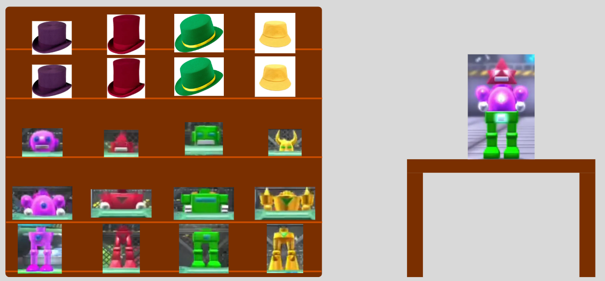
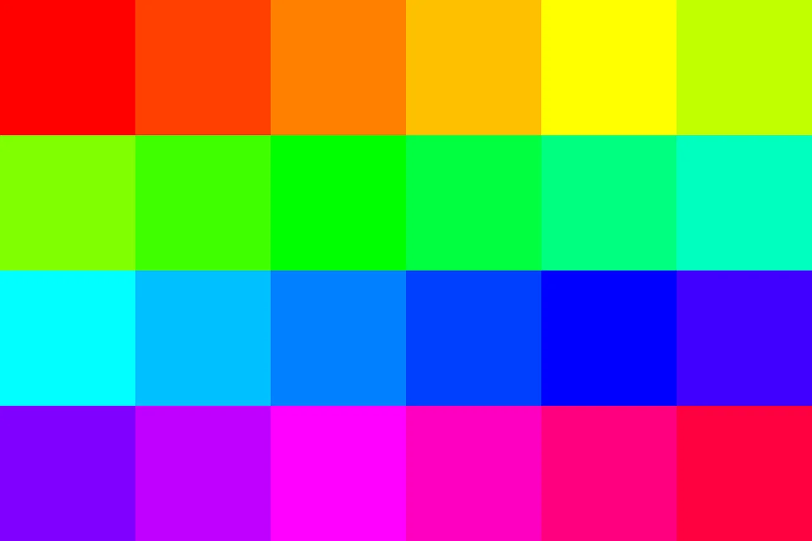

# Game Concept Document

Versienummer : 1

Auteur : Thijmen, Marijn

Studentnummer : 0266883, 0265825

Klas : 24SDG

Datum : 2026-09-30

## Versiebeheer

| Datum      | Versie | Wie | Wijzigingen |
| ---------- | ------ | --- | ----------- |
| 2026-09-30 | 1.0    | Thijmen    | Game Concept Document ingevuld|
| 2026-09-30 | 1.0    | Marijn    | Game Concept Document ingevuld|
|            |        |     |             |

## Inhoudsopgave

- [Game Concept Document](#game-concept-document)
  - [Versiebeheer](#versiebeheer)
  - [Inhoudsopgave](#inhoudsopgave)
  - [Inleiding](#inleiding)
    - [Over dit document](#over-dit-document)
    - [Over het project en de opdrachtgever](#over-het-project-en-de-opdrachtgever)
  - [Game Overzicht](#game-overzicht)
    - [Genre](#genre)
    - [Doelgroep](#doelgroep)
    - [Platform](#platform)
    - [Speelstijl](#speelstijl)
  - [Verhaal en Setting](#verhaal-en-setting)
    - [Verhaal](#verhaal)
    - [Setting en Wereld](#setting-en-wereld)
    - [Personages](#personages)
  - [Gameplay Mechanics](#gameplay-mechanics)
    - [Core Loop](#core-loop)
    - [Controls](#controls)
    - [Progressie en Beloningen](#progressie-en-beloningen)
  - [Art Style en Audio](#art-style-en-audio)
    - [Visuele Stijl](#visuele-stijl)
    - [Audio en Muziek](#audio-en-muziek)
  - [Technische Vereisten](#technische-vereisten)
  - [Scope en Planning](#scope-en-planning)
  - [Onderbouwing](#onderbouwing)

## Inleiding

### Over dit document

In dit document wordt het game concept beschreven. Het geeft een overzicht van de gameplay mechanics, de visuele stijl en de technische vereisten van het te ontwikkelen spel.

### Over het project en de opdrachtgever

De opdrachtgever heet Marjan de Jonge van Ruby Campus. Bij Ruby proberen ze inwoners en MKB bedrijven in Noord-Nederland te digitaliseren. Ruby wil het gebouw ontwikkelen tot een inspirerende plek waar kunst, technologie en innovatie samenkomen. Onze game gaat gebruikt worden om basis school studenten te introduceren aan VR.

## Game Overzicht

In het spel moet je een robot in elkaar zetten waardoor hij "tot leven komt" en op dingen kan reageren door animaties en een tekstbubbel boven zijn hoofd.
Verder zijn er andere interactieve dingen in de kamer om mee te spelen (blokken, basketbal net met bal, etc).

### Genre

| Kenmerk      | Beschrijving |
| ------------ | ------------ |
| Hoofdgenre   | Sandbox      |
| Sub-genre(s) | physics sandbox |
| Inspiratie   | Assemble Bots van Wii Party U |

### Doelgroep

| Kenmerk          | Beschrijving |
| ---------------- | ------------ |
| Leeftijdsgroep   |  Dit project word gemaakt voor kinderen in groep acht (11-13 jaar).|
| Gamingervaring   | geen/minimaal |
| Interesses       | vr/sandbox games |
| PEGI-classificatie | Pegi 3     |

### Platform

| Platform | Versie / Specificaties |
| -------- | ---------------------- |
| computer/VR | een computer die VR kan runnen, een vr headset met 2 controllers. |
|          |                        |

### Speelstijl

| Kenmerk        | Beschrijving |
| -------------- | ------------ |
| Perspectief    | First Person |
| Spelersmodus   | Singeplayer  |
| Sessie lengte  | 5-15 minuten |

## Verhaal en Setting

### Verhaal

Deze game heeft geen verhaallijn, omdat het een sandbox Game is.

### Setting en Wereld

| Kenmerk       | Beschrijving |
| ------------- | ------------ |
| Tijdsperiode  | hedendaags   |
| Locatie(s)    | Kinder(slaap) kamer |
| Sfeer / Toon  | relaxed en kalm |
| Bijzonderheden | geen        |

### Personages

Er zijn geen belangrijke personages omdat het een sandbox game is.

## Gameplay Mechanics

### Core Loop

- De speler verkent een ruimte → vindt items → gebruik items voor minigames → reactie van gemaakte robot

### Controls

| Actie       | Toets / Knop | Platform |
| ----------- | ------------ | -------- |
| Bewegen     | linker joystick | VR    |
| Springen    | A knop       | VR       |
| Draaien     | Rechter joystick | VR   |
| Knijpen     | Trigger button links en rechts | VR |
| Oppakken    | Grip button links en rechts | VR |
| Menu        | Menu button | VR        |

### Progressie en Beloningen

| Type       | Beschrijving |
| ---------- | ------------ |
| Progressie | Een robot in elkaar zetten |
| Unlocks    | De robot krijgen die in elkaar is gezet |
| Beloningen | reacties van gemaakte robot krijgen |

## Art Style en Audio

### Visuele Stijl

| Kenmerk          | Beschrijving |
| ---------------- | ------------ |
| ModelStijl       | low poly meshes |
| UI-stijl         | Cartoony     |
| Referentiespellen | Model: Muck, UI: Slime rancher 2 |
| Kleurenpalet     | Felle makkelijk te identificeerbaar (foto hier onder) |

### Audio en Muziek

| Kenmerk           | Beschrijving |
| ----------------- | ------------ |
| Muziekstijl       | Ambient      |
| Sfeer             | rustige achtergrond muziek |
| Geluidseffecten   | wanneer objecten worden opgepakt/als er op word gericht |
| Stemopnames       | geen         |

## Technische Vereisten

| Onderdeel            | Keuze / Versie | Reden |
| -------------------- | -------------- | ----- |
| Game Engine          | Unity          | Wij hebben het meeste ervaring in Unity en Unity heeft een goede basis voor VR projecten. |
| Programmeertaal      | C#             | Dit is de taal die gebruikt word in Unity. |
| Versiebeheersysteem  | Git            | Alle game engines ondersteunen Git. |
| Art tool(s)          | Blender        | Blender is gratis en wij hebben allebei ervaring hierin. |
| Audio tool(s)        | Unity Native Audio System | is ingebouwd in Unity |

**Minimale systeemvereisten (speler):**

| Kenmerk    | Minimaal | Aanbevolen |
| ---------- | -------- | ---------- |
| OS         | Windows 10 64-bit | Windows 11 64-bit |
| Processor  | Intel Core i5 of AMD Ryzen 5 | AMD Ryzen 7 9800X3D |
| RAM        | 8 GB RAM | 16 GB RAM  |
| GPU        | NVIDIA GeForce GTX 1070 of AMD Radeon RX 6600 XT| NVIDIA GeForce RTX 3060 |
| Opslag     | 512 GB  | 1 TB        |

## Scope en Planning

### MoSCoW

| Prioriteit  | Feature / Onderdeel | Toelichting |
| ----------- | ------------------- | ----------- |
| Must have   | VR-ondersteuning en basisbeweging | Dit is nodig voor standaard VR functionaliteit. |
| Should have | Geavanceerde interacties | De robot maker machine combineert meerdere models samen. |
| Could have  | Geavanceerde audio | Zodat de ervaring meer realistisch is. |
| Won't have  | Een verhaal | Dit is niet nodig in een sandbox game en de bedoeling van de game is om VR te leren. |

### Globale Planning

| Sprint / Week | Doel | Deliverable |
| ------------- | ---- | ----------- |
| Week 1        | Basis elementen game | ja |
| Week 2        | robot maker machine | ja |
| Week 3        | robot praten/emoties geven | ja |
| Week 4        | Playtesting van leerlingen/studenten | ja |

## Onderbouwing

**Haalbaarheid:**

Het game design van ons project is te halen omdat we redelijk wat ervaring hebben in Unity en vooral low poly models gaan maken.

De technologie is te halen omdat we vooral 2 grote functies nodig hebben (robot machine maker en de robot persoonlijkheden/emoties). We kunnen hierdoor makkelijk taken verdelen zodat eerst 1 iemand de machine kan doen en de ander de emoties. Terwijl het andere teamlid bezig is met een grote functie kan er veel gedaan worden aan kleinere systemen, zodat we de hele tijd bezig zijn.

Wij denken dat dit project te halen is in 4 sprints/weken omdat we gaan werken in de preset van VR Unity, waardoor de basis van sommige vr punten gedaan zijn.

**Risico's en maatregelen:**

| Risico | Kans | Impact | Maatregel |
| ------ | ---- | ------ | --------- |
| Tijd loopt uit op belangrijke systemen | Midden | Hoog | Wanneer er problemen komen word dit aangegeven en gaat er gezamelijk gewerkt worden aan het probleem |
| Veel tijd kwijt aan models maken | groot | laag | Als de models niet op tijd af komen kunnen er assets gebruikt worden om deze te vervangen |
