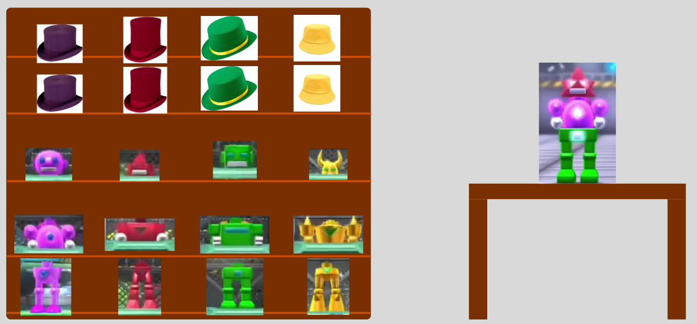
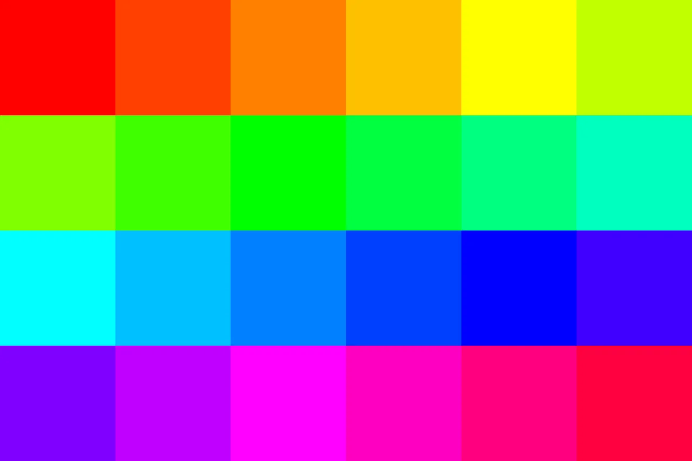

# Game Concept Document

Versienummer : 1.2

Auteur : Thijmen, Marijn

Studentnummer : 0266883, 0265825

Klas : 24SDG

Datum : 2026-11-4

## Versiebeheer

| Datum      | Versie | Wie | Wijzigingen |
| ---------- | ------ | --- | ----------- |
| 2026-09-30 | 1.0    | Thijmen    | Game Concept Document ingevuld|
| 2026-09-30 | 1.0    | Marijn     | Game Concept Document ingevuld|
| 2026-10-05 | 1.1    | Marijn     | Spelfouten en punctuatie verbeterd|
| 2026-10-29 | 1.2    | Thijmen    | Uitleg opdrachtgever verbetert|
| 2026-11-4  | 1.3    | Thijmen    | Onderbouwing ingevuld|
| 2026-11-4  | 1.3    | Marijn     | Onderbouwing ingevuld|

## Inhoudsopgave

- [Game Concept Document](#game-concept-document)
  - [Versiebeheer](#versiebeheer)
  - [Inhoudsopgave](#inhoudsopgave)
  - [Inleiding](#inleiding)
    - [Over dit document](#over-dit-document)
    - [Over het project en de opdrachtgever](#over-het-project-en-de-opdrachtgever)
  - [Game Overzicht](#game-overzicht)
    - [Genre](#genre)
    - [Doelgroep](#doelgroep)
    - [Platform](#platform)
    - [Speelstijl](#speelstijl)
  - [Verhaal en Setting](#verhaal-en-setting)
    - [Verhaal](#verhaal)
    - [Setting en Wereld](#setting-en-wereld)
    - [Personages](#personages)
  - [Gameplay Mechanics](#gameplay-mechanics)
    - [Core Loop](#core-loop)
    - [Controls](#controls)
    - [Progressie en Beloningen](#progressie-en-beloningen)
  - [Art Style en Audio](#art-style-en-audio)
    - [Visuele Stijl](#visuele-stijl)
    - [Audio en Muziek](#audio-en-muziek)
  - [Technische Vereisten](#technische-vereisten)
  - [Scope en Planning](#scope-en-planning)
  - [Onderbouwing](#onderbouwing)

## Inleiding

### Over dit document

In dit document wordt het game concept beschreven. Het geeft een overzicht van de gameplay mechanics, de visuele stijl en de technische vereisten van het te ontwikkelen spel.

### Over het project en de opdrachtgever

De opdrachtgever van ons project heet Marjan de Jonge en ze is van van Ruby Campus. Je kan bij Ruby langskomen als je vragen hebt over wat digitale ontwikkeling in jouw leven kan betekenen. Bij Ruby ondersteunen ze ondernemers met slimme adviezen om processen te verbeteren, bereik te vergroten en kansen te grijpen. En ze helpen studenten door hen opdrachten te geven om hun digitale skills sterker te maken. Ze hebben bijvoorbeeld een workshop gehad over hoe je met AI kan werken en ze hebben een toeristische databank genaamd Touripedia officieel gelanceerd bij Ruby zelf.

## Game Overzicht

In het spel moet je een robot in elkaar zetten waardoor hij "tot leven komt" en op dingen kan reageren door animaties en een tekstbubbel boven zijn hoofd.
Verder zijn er andere interactieve dingen in de kamer om mee te spelen (blokken, basketbal net met bal, etc).

### Genre

| Kenmerk      | Beschrijving |
| ------------ | ------------ |
| Hoofdgenre   | Sandbox      |
| Sub-genre(s) | Physics sandbox |
| Inspiratie   | Assemble Bots van Wii Party U |

### Doelgroep

| Kenmerk          | Beschrijving |
| ---------------- | ------------ |
| Leeftijdsgroep   |  Dit project word gemaakt voor kinderen in groep acht (11-13 jaar).|
| Gamingervaring   | Geen/Minimaal |
| Interesses       | VR/Sandbox games |
| PEGI-classificatie | Pegi 3     |

### Platform

| Platform | Versie / Specificaties |
| -------- | ---------------------- |
| Computer/VR | Een computer die VR kan runnen, een VR headset met 2 controllers. |
|          |                        |

### Speelstijl

| Kenmerk        | Beschrijving |
| -------------- | ------------ |
| Perspectief    | First Person |
| Spelersmodus   | Singeplayer  |
| Sessie lengte  | 5-15 Minuten |

## Verhaal en Setting

### Verhaal

Deze game heeft geen verhaallijn, omdat het een sandbox Game is.

### Setting en Wereld

| Kenmerk       | Beschrijving |
| ------------- | ------------ |
| Tijdsperiode  | Hedendaags   |
| Locatie(s)    | Kinder(slaap) kamer |
| Sfeer / Toon  | Relaxed en kalm |
| Bijzonderheden | Geen        |

### Personages

Er zijn geen belangrijke personages, omdat het een sandbox game is.

## Gameplay Mechanics

### Core Loop

- De speler verkent een ruimte in VR → vindt items zoals: Dartpijlen, bowlingbal, basketbal. → gebruik deze items om punten te scoren in de minigames → Door punten te scoren krijg je een reactie van de robot

### Controls

| Actie       | Toets / Knop | Platform |
| ----------- | ------------ | -------- |
| Bewegen     | Linker joystick | VR    |
| Springen    | A knop       | VR       |
| Draaien     | Rechter joystick | VR   |
| Knijpen     | Trigger button links en rechts | VR |
| Oppakken    | Grip button links en rechts | VR |
| Menu        | Menu button | VR        |

### Progressie en Beloningen

| Type       | Beschrijving |
| ---------- | ------------ |
| Progressie | Een robot in elkaar zetten |
| Unlocks    | De robot krijgen die in elkaar is gezet |
| Beloningen | Reacties van gemaakte robot krijgen |

## Art Style en Audio

### Visuele Stijl

| Kenmerk          | Beschrijving |
| ---------------- | ------------ |
| ModelStijl       | Low poly meshes |
| UI-stijl         | Cartoony     |
| Referentiespellen| Model: Muck, UI: Slime rancher 2 |
| Kleurenpalet     | Felle makkelijk te identificeerbaar (foto hier onder) |

### Audio en Muziek

| Kenmerk           | Beschrijving |
| ----------------- | ------------ |
| Muziekstijl       | Ambient      |
| Sfeer             | Rustige achtergrond muziek |
| Geluidseffecten   | Wanneer objecten worden opgepakt/als er op word gericht |
| Stemopnames       | Geen         |

## Technische Vereisten

| Onderdeel            | Keuze / Versie | Reden |
| -------------------- | -------------- | ----- |
| Game Engine          | Unity          | Wij hebben het meeste ervaring in Unity en Unity heeft een goede basis voor VR projecten. |
| Programmeertaal      | C#             | Dit is de taal die gebruikt word in Unity. |
| Versiebeheersysteem  | Git            | Alle game engines ondersteunen Git. |
| Art tool(s)          | Blender        | Blender is gratis en wij hebben allebei ervaring hierin. |
| Audio tool(s)        | Unity Native Audio System | Is ingebouwd in Unity |

**Minimale systeemvereisten (speler):**

| Kenmerk    | Minimaal | Aanbevolen |
| ---------- | -------- | ---------- |
| OS         | Windows 10 64-bit | Windows 11 64-bit |
| Processor  | Intel Core i5 of AMD Ryzen 5 | AMD Ryzen 7 9800X3D |
| RAM        | 8 GB RAM | 16 GB RAM  |
| GPU        | NVIDIA GeForce GTX 1070 of AMD Radeon RX 6600 XT| NVIDIA GeForce RTX 3060 |
| Opslag     | 512 GB  | 1 TB        |

## Scope en Planning

### MoSCoW

| Prioriteit  | Feature / Onderdeel | Toelichting |
| ----------- | ------------------- | ----------- |
| Must have   | VR-ondersteuning en basisbeweging | Dit is nodig voor standaard VR functionaliteit. |
| Should have | Geavanceerde interacties | De robot maker machine combineert meerdere models samen. |
| Could have  | Geavanceerde audio | Zodat de ervaring meer realistisch is. |
| Won't have  | Een verhaal | Dit is niet nodig in een sandbox game en de bedoeling van de game is om VR te leren. |

### Globale Planning

| Sprint / Week | Doel | Deliverable |
| ------------- | ---- | ----------- |
| Week 1        | Basis elementen game | ja |
| Week 2        | Robot maker machine | ja |
| Week 3        | Robot praten/emoties geven | ja |
| Week 4        | Playtesting van leerlingen/studenten | ja |

Link naar volledige planning: https://github.com/users/ThijmenE/projects/6/views/3

## Onderbouwing

Genre
We hebben gekozen voor een VR sandbox game omdat Ruby graag VR wil introduceren aan jongeren (12 jaar/groep 8).
De game moet dus simpel op te pakken zijn voor kinderen met weinig/geen game ervaring.
In een sandbox is geen risico en kun je onze minigames leren waardoor ze een goede eerste VR ervaring kunnen krijgen.

Doelgroep
De doelgroep is basischool leerlingen (rond de 12 jaar oud).
We hebben deze doelgroep omdat we in overleg met Ruby hebben besloten een VR game te maken voor basischool leerlingen omdat ze graag een introductie willen geven aan VR.

Platform
Onze game is in VR omdat de opdrachtgever graag een VR game wil hebben om jongeren te introduceren aan VR.

Speelstijl
Het spel moet simpel zijn zodat het makkelijk opgepakt kan worden door leerlingen.
Daarom leek ons singeplayer de beste keuze omdat het niet competatief kan worden wanneer je alleen speelt.
Verder is de bedoelde speel sessie van ons spel 5-15 minuten omdat het alleen bedoelt is om een introductie te zijn aan VR en daarom waarschijnlijk alleen op locatie bij Ruby gespeelt kan worden.

Verhaal
Omdat de spelers alleen bij Ruby kunnen spelen, waardoor de game niet lang gespeelt kan worden en omdat het een sandbox game is hebben we besloten er geen verhaal aan de game toe te voegen.

Setting en Wereld
Het speelt af in een (kinder)kamer omdat het goed bij de doelgroep past en een rustige omgeving is, wat weer past bij onze sfeer.
Omdat de game in een hedendaagse tijd afspeelt past een moderne (kinder)kamer goed bij onze sfeer.

Personages
Wij hebben geen belangrijke personages in onze game omdat de game alleen op locatie bij Ruby gespeelt kan worden, waardoor je niet in een verhaal kan komen met allemaal personages en vinden wij dat in een sandbox game geen personages nodig zijn.

Core Loop
We hebben een makkelijke core loop gekozen waarbij de speler een kamer in vr kan ontdekken en minigames kan spelen.
Hierdoor kan de speler vrij rondlopen en doen wat hij of zij wil.
In de kamer zijn verschillende minigames te spelen waarbij je reacties kan krijgen van de robot. Dit past goed bij onze game omdat het spel makkelijk te begrijpen is.

Controls
We hebben de controls van de game gekozen door wat voor ons natuurlijk voelt (grip button voor dingen oppakken omdat je dan knijpt, trigger knop voor UI knoppen omdat dat voelt als een select knop).
En de menu knoppen kunnen niet echt natuurlijk voelen maar daarom hebben we ze allemaal op de linker controller gestopt zodat het overzichtelijk blijft.

Progressie en Beloningen
De progressie in onze game komt neer op het maken van de robot.
Zodra de robot er is zal hij positief reageren op de minigames die je hebt gespeeld.
De beloning is de reacties van de robot voor deze minigames.

Visuele Stijl
Voor de game willen we een kleurrijk kleurpalet gebruiken omdat het voor jongere kinderen gemaakt word en daarom goed bij onze doelgroep zal passen.
Verder willen we een cartoony font hebben voor onze UI teksten om dezelfde reden

Audio en Muziek
We hebben een rustige achtergrond muziek in de game gestopt om te helpen met de sfeer van de game.

**Haalbaarheid:**

Het game design van ons project is te halen, omdat we redelijk wat ervaring hebben in Unity en vooral low poly models gaan maken.

De technologie is te halen, omdat we vooral 2 grote functies nodig hebben (robot machine maker en de robot persoonlijkheden/emoties). We kunnen hierdoor makkelijk taken verdelen zodat eerst 1 iemand de machine kan doen en de ander de emoties. Terwijl het andere teamlid bezig is met een grote functie kan er veel gedaan worden aan kleinere systemen, zodat we de hele tijd bezig zijn.

Wij denken dat dit project te halen is in 4 sprints/weken omdat we gaan werken in de preset van VR Unity, waardoor de basis van sommige vr punten gedaan zijn.

**Risico's en maatregelen:**

| Risico | Kans | Impact | Maatregel |
| ------ | ---- | ------ | --------- |
| Tijd loopt uit op belangrijke systemen | Midden | Hoog | Wanneer er problemen komen word dit aangegeven en gaat er gezamelijk gewerkt worden aan het probleem |
| Veel tijd kwijt aan models maken | groot | laag | Als de models niet op tijd af komen kunnen er assets gebruikt worden om deze te vervangen |
