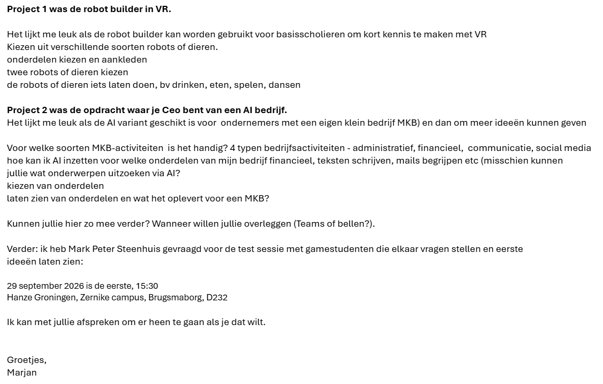

# Programma van Eisen

Versienummer : 1.3

Auteur : Thijmen, Marijn

Studentnummer : 0266883, 0265825

Klas : 24SDG

Datum : 2026-10-01

## Versiebeheer

| Datum      | Versie | Wie | Wijzigingen |
| ---------- | ------ | --- | ----------- |
| 2026-10-01 | 1.0    | Thijmen | PvE ingevuld |
| 2026-10-01 | 1.0    | Marijn  | PvE ingevuld |
| 2026-10-05 | 1.1    | Marijn  |Spelfouten en punctuatie verbeterd |
| 2026-10-29 | 1.2    | Marijn  |Moscow beter genoteerd en foto toegevoegd|
| 2026-10-29 | 1.3    | Thijmen    | Uitleg opdrachtgever verbeterd|

## Inhoudsopgave

- [Programma van Eisen](#programma-van-eisen)
  - [Versiebeheer](#versiebeheer)
  - [Inhoudsopgave](#inhoudsopgave)
  - [Inleiding](#inleiding)
    - [Over dit document](#over-dit-document)
    - [Over het project en de opdrachtgever](#over-het-project-en-de-opdrachtgever)
  - [Behoeftebeschrijving opdrachtgever](#behoeftebeschrijving-opdrachtgever)
    - [Informatiebronnen](#informatiebronnen)
    - [Eisen en wensen (MoSCoW)](#eisen-en-wensen-moscow)
  - [Betrokkenen](#betrokkenen)
  - [Projectgrenzen](#projectgrenzen)
  - [Technische eisen](#technische-eisen)

## Inleiding

### Over dit document

In dit document worden de uit te voeren werkzaamheden, projectdoelstellingen, besprekingen en opleveringen vastgelegd. Het een en ander wordt in een logische chronologisch volgorde in een strokenplanning opgenomen.

### Over het project en de opdrachtgever

De opdrachtgever van ons project heet Marjan de Jonge en ze is van van Ruby Campus. Je kan bij Ruby langskomen als je vragen hebt over wat digitale ontwikkeling in jouw leven kan betekenen. Bij Ruby ondersteunen ze ondernemers met slimme adviezen om processen te verbeteren, bereik te vergroten en kansen te grijpen. En ze helpen studenten door hen opdrachten te geven om hun digitale skills sterker te maken. Ze hebben bijvoorbeeld een workshop gehad over hoe je met AI kan werken en ze hebben een toeristische databank genaamd Touripedia officieel gelanceerd bij Ruby zelf.

## Behoeftebeschrijving opdrachtgever

### Informatiebronnen

Afstemming gesprek: B1-K2/Opdracht-5/Videos/VR project opdracht afstemmen ruby.mp4

### Eisen en wensen (MoSCoW)

Must have
- : De game moet makkelijk en simpel te spelen zijn.
- : De gebruiker kan robot bouwen door robotonderdelen te kiezen.
- : Robots moeten iets kunnen doen (drinken, eten, spelen, dansen).
- : Er moet meer te doen zijn dan alleen met robots spelen (minigames: darten, basketbal, bowlen, bouwblokken).

Should have
- : Robots kunnen aankleden (Verschillende accessoires).
- : Meerdere robots.
- : Thema van game moet een kinderkamer zijn.

Could have
- : Robotonderdelen liggen door de kamer verspreid.

Won't have (now)
- : Dieren (zal niet goed werken met het concept).

## Betrokkenen

Thijmen: Projectleider, programmeur, modelleur, +31682009171, taeggens@st.noorderpoort.nl

Marijn: Notulist, programmeur, modelleur, aanspreekpunt, +31633677013, mlubbers5@st.noorderpoort.nl

## Projectgrenzen

Zodra het project is afgerond, krijgt Ruby het project en komen er geen updates meer (tenzij er een gamebreaking bug in de game zit). Er komen geen transacties in de game voor echt geld. De game is bedoeld om kort gespeeld te worden, dus er komen geen uitbreidingen. Omdat de game bedoeld is voor jonge kinderen, komen er geen realistisch geweld of seksuele onderwerpen in de game voor.

## Technische eisen

Om de game te runnen, heb je een computer/laptop nodig die VR ondersteunt. Verouderde systemen gaan waarschijnlijk geen VR-projecten kunnen runnen. Daarom stellen we voor dat je ten minste Windows 10/11 hebt of alternatief macOS 10.15 of hoger. En natuurlijk heb je een VR-headset nodig. Alle nieuwere VR-headsets werken voor ons project.