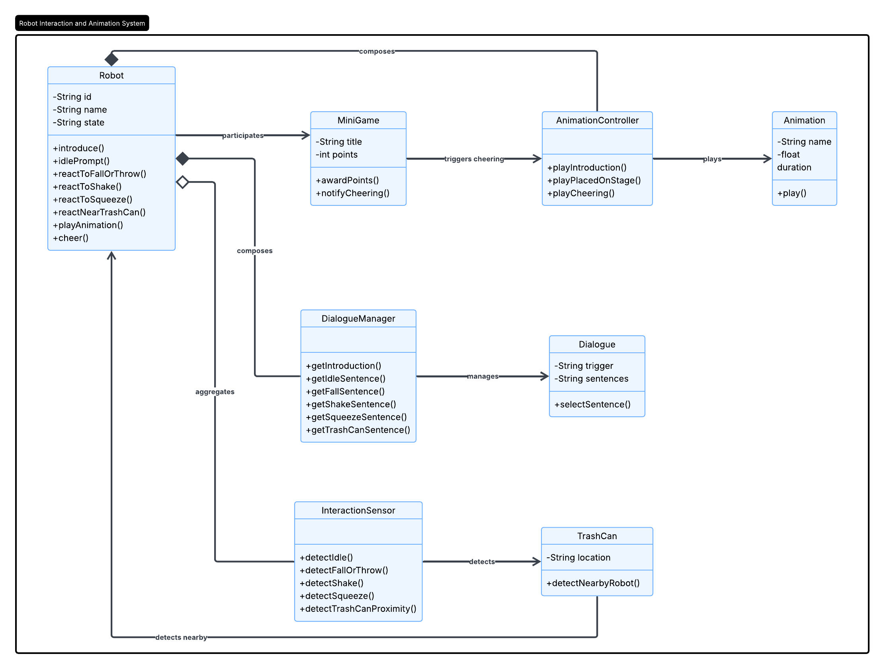
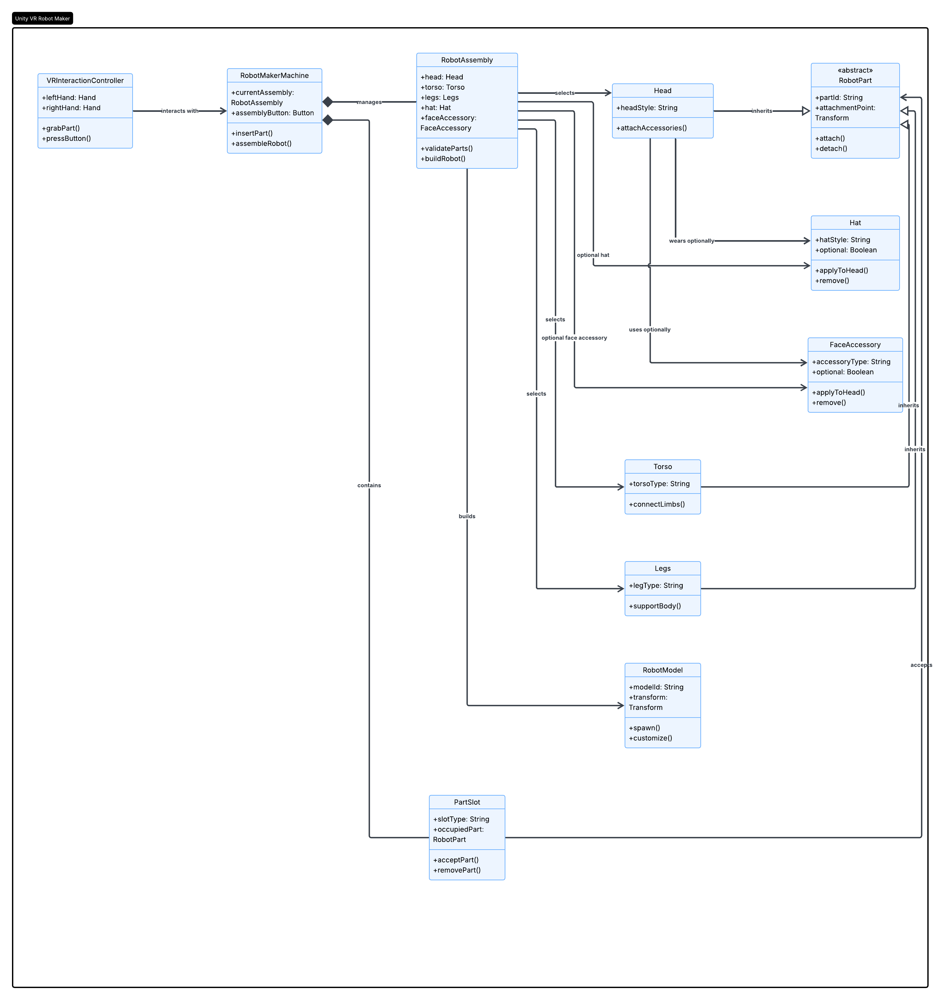

# Technisch Ontwerp

Versienummer : 1

Auteur : Thijmen, Marijn

Studentnummer : 0266883, 0265825

Klas : 24SDG

Datum : 2026-10-05

## Versiebeheer

| Datum      | Versie | Wie | Wijzigingen |
| ---------- | ------ | --- | ----------- |
| 2026-10-05 | 1.0    | Thijmen | functioneel ontwerp ingevuld |
| 2026-10-05 | 1.0    | Marijn | functioneel ontwerp ingevuld |
| 2026-10-29 | 1.1    | Thijmen    | Uitleg opdrachtgever verbetert|

## Inhoudsopgave

- [Technisch Ontwerp](#technisch-ontwerp)
  - [Versiebeheer](#versiebeheer)
  - [Inhoudsopgave](#inhoudsopgave)
  - [Inleiding](#inleiding)
    - [Over dit document](#over-dit-document)
    - [Over het project en de opdrachtgever](#over-het-project-en-de-opdrachtgever)
  - [Applicatie componenten](#applicatie-componenten)
  - [Ontwerp](#ontwerp)
    - [Ontwerp van gegevens](#ontwerp-van-gegevens)
    - [Programmalogica](#programmalogica)
    - [User interface](#user-interface)
  - [Software en techniek](#software-en-techniek)
  - [Onderbouwing](#onderbouwing)

## Inleiding

### Over dit document

In dit document wordt inzicht gegeven over de verschillende technieken die gebruikt gaan worden tijdens het ontwikkelen van de applicatie.

### Over het project en de opdrachtgever

De opdrachtgever van ons project heet Marjan de Jonge en ze is van van Ruby Campus. Je kan bij Ruby langskomen als je vragen hebt over wat digitale ontwikkeling in jouw leven kan betekenen. Bij Ruby ondersteunen ze ondernemers met slimme adviezen om processen te verbeteren, bereik te vergroten en kansen te grijpen. En ze helpen studenten door hen opdrachten te geven om hun digitale skills sterker te maken. Ze hebben bijvoorbeeld een workshop gehad over hoe je met AI kan werken en ze hebben een toeristische databank genaamd Touripedia officieel gelanceerd bij Ruby zelf.

## UML Diagrammen

## Software en techniek

Wij werken met Unity Editor version 6000.4.3f1. Achter alle methods willen we notities hebben staan zodat we ook later goed weten wat alle code deed. Wij programeren met Camelcase. Wij gaan werken in een Github repository, waarin we per feature een branch aanmaken. De code word eerst getest op die branch door een groepsgenoot voordat die gemerged word naar de main branch.

## Onderbouwing

In onze ontwerpkeuzes is haalbaarheid goed te doen. Wij hebben User stories gemaakt op onze planning waar een duidelijke tijdsindicatie bij staat.

Er zijn geen problemen met privacy omdat er geen data word gevraagd van de gebruiker en de game lokaal word gelanceerd.

In ons project hebben we geen security problemen omdat het lokaal word gelanceerd en en geen data word opgeslagen.

Ons project voldoet aan de eisen van de AVG en OWASP-top 10