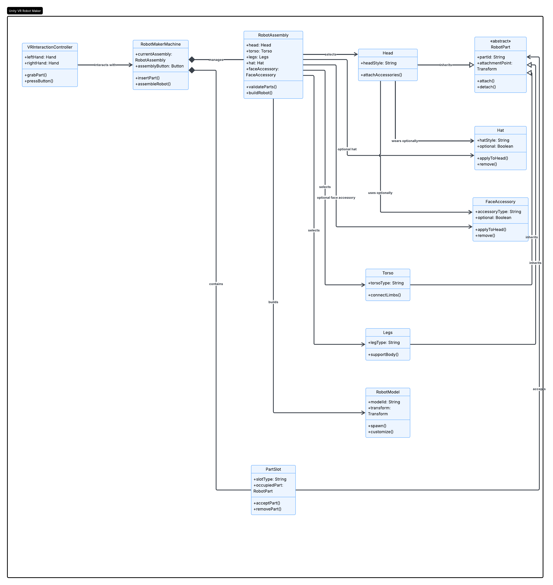
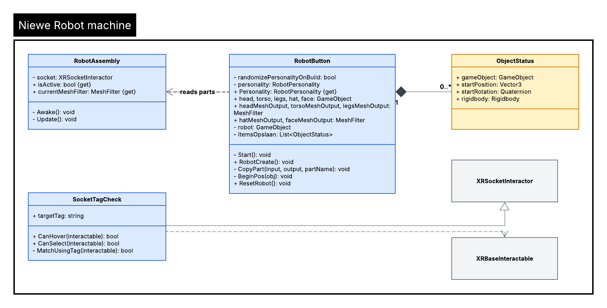
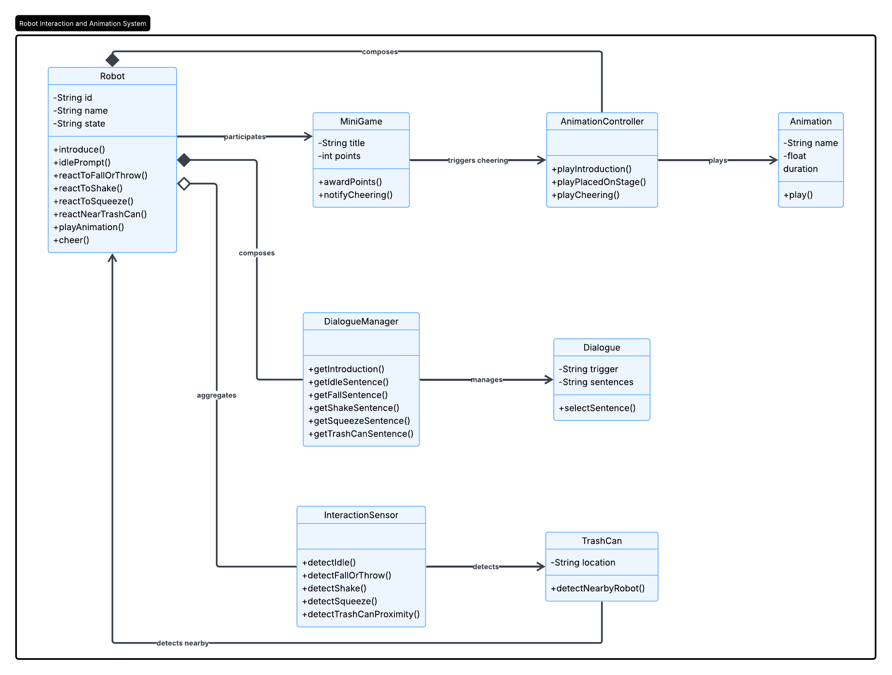
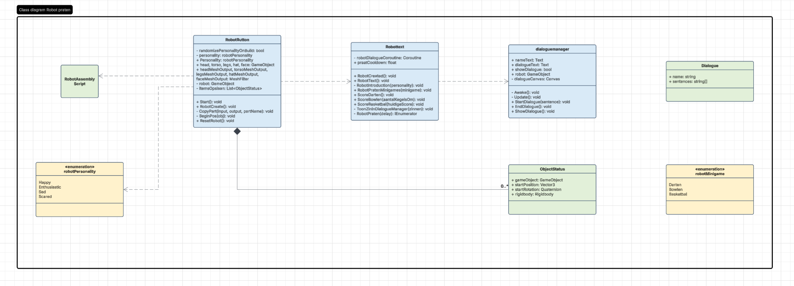

# Technisch Ontwerp

Versienummer : 1.3

Auteur : Thijmen, Marijn

Studentnummer : 0266883, 0265825

Klas : 24SDG

Datum : 2026-11-16

## Versiebeheer

| Datum      | Versie | Wie | Wijzigingen |
| ---------- | ------ | --- | ----------- |
| 2026-10-05 | 1.0    | Thijmen | functioneel ontwerp ingevuld |
| 2026-10-05 | 1.0    | Marijn  | functioneel ontwerp ingevuld |
| 2026-10-29 | 1.1    | Thijmen | Uitleg opdrachtgever verbeterd |
| 2026-11-12 | 1.2    | Marijn  | Spelfouten en interpunctie verbeterd |
| 2026-11-16 | 1.3    | Marijn  | Nieuwe UML Charts toegevoegd |
| 2026-11-16 | 1.3    | Thijmen | Uitleg van eigen UML diagrammen toegevoegd |

## Inhoudsopgave

- [Technisch Ontwerp](#technisch-ontwerp)
  - [Versiebeheer](#versiebeheer)
  - [Inhoudsopgave](#inhoudsopgave)
  - [Inleiding](#inleiding)
    - [Over dit document](#over-dit-document)
    - [Over het project en de opdrachtgever](#over-het-project-en-de-opdrachtgever)
  - [Applicatie componenten](#applicatie-componenten)
  - [Ontwerp](#ontwerp)
    - [Ontwerp van gegevens](#ontwerp-van-gegevens)
    - [Programmalogica](#programmalogica)
    - [User interface](#user-interface)
  - [Software en techniek](#software-en-techniek)
  - [Onderbouwing](#onderbouwing)

## Inleiding

### Over dit document

In dit document wordt inzicht gegeven over de verschillende technieken die gebruikt gaan worden tijdens het ontwikkelen van de applicatie.

### Over het project en de opdrachtgever

De opdrachtgever van ons project heet Marjan de Jonge en ze is van van Ruby Campus. Je kan bij Ruby langskomen als je vragen hebt over wat digitale ontwikkeling in jouw leven kan betekenen. Bij Ruby ondersteunen ze ondernemers met slimme adviezen om processen te verbeteren, bereik te vergroten en kansen te grijpen. En ze helpen studenten door hen opdrachten te geven om hun digitale skills sterker te maken. Ze hebben bijvoorbeeld een workshop gehad over hoe je met AI kan werken en ze hebben een toeristische databank genaamd Touripedia officieel gelanceerd bij Ruby zelf.

## UML Diagrammen

Dit is de oude UML diagram. In deze diagram had ik eerst bedacht om alle onderdelen in aparte scripts aan elkaar te linken, maar terwijl ik het aan het maken was kwam ik erachter dat ik gameobjects kon linken aan elkaar. Deze onderdelen nemen de mesh en kleur over van elkaar naar de robot zelf.

Dit is de nieuwe UML diagram. Hier kun je zien dat ik in 1 script alle robot onderdelen als gameobjects heb verbonden zodat ik de mesh en kleur makkelijk kon overzetten naar de robot zelf. De mesh en kleur worden als child object uit de Socket interactors (Unity VR library script) gehaald en word dan overgezet naar het doel object.

Dit is de oude UML diagram. In deze UML is alles los van elkaar gemaakt, maar tijdens het coderen kwam ik erachter dat het op een makkelijkere manier kon. Ik kon namelijk de Minigames praten voor de robot in een script gooien samen met het praten van de robot. Dit zorgde ervoor dat het gezamelijk in een script stond. Wij hebben tijdens het project ervoor gekozen om animaties van de robot niet te gaan gebruiken, dus dan kon er ook uit. Hieronder zie je de nieuwe UML die ik heb gemaakt.

Dit is de nieuwe UML diagram. Ik heb 3 verschilende script gemaakt voor het praten van de robot. Robottext, dialoguemanager en Dialogue. Ik heb van Thijmen zijn Robotbutton de persoonlijkheid toegevoegd. Zelf vind ik de nieuwe UML een stuk beter, omdat het vergeleken met de andere UML het er een stuk overzichtelijker eruit ziet.

## Software en techniek

Wij werken met Unity Editor version 6000.4.3f1. Achter alle methods willen we notities hebben staan, zodat we ook later goed weten wat alle code deed. Wij programmeren met CamelCase. Wij gaan werken in een GitHub-repository, waarin we per feature een branch aanmaken. De code wordt eerst getest op die branch door een groepsgenoot voordat die gemerged wordt naar de main branch.

## Onderbouwing

In onze ontwerpkeuzes is de haalbaarheid goed te doen. Wij hebben user stories gemaakt voor onze planning, waar een duidelijke tijdsindicatie bij staat.

Er zijn geen problemen met privacy, omdat er geen data wordt gevraagd van de gebruiker en de game lokaal wordt gelanceerd.

In ons project hebben we geen securityproblemen, omdat de game lokaal wordt gelanceerd en er geen data wordt opgeslagen.

Ons project voldoet aan de eisen van de AVG en de OWASP Top 10.