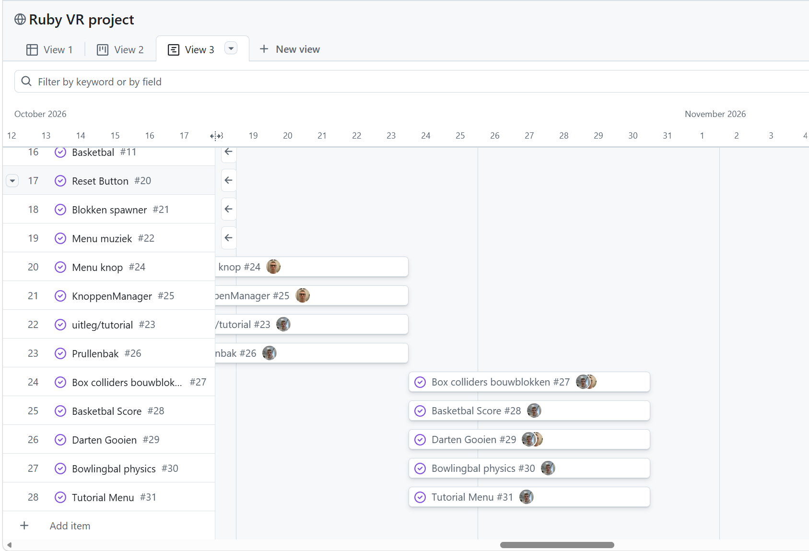

# Verbetervoorstellen

Versienummer : 1

Auteur : Thijmen, Marijn

Studentnummer : 0266883, 0265825

Klas : 24SDG

Datum : 2026-11-16

## Versiebeheer

| Datum      | Versie | Wie | Wijzigingen |
| ---------- | ------ | --- | ----------- |
| 2026-11-16 | 1.0    | Thijmen | verbetervoorstellen op basis van je testen ingevuld |

## Inhoudsopgave

- [verbetervoorstellen op basis van je testen](#verbetervoorstellen-op-basis-van-je-testen)
- [verbetervoorstellen op basis van je oplevering](#verbetervoorstellen-op-basis-van-je-oplevering)
- [verbetervoorstellen op basis van je reflectie](#verbetervoorstellen-op-basis-van-je-reflectie)
- [Planning verbetervoorstellen](#planning-verbetervoorstellen)

## Verbetervoorstellen op basis van je testen

Dingen die wij nog moeten aanpassen en hoe wij dat gaan doen:

### Box Colliders (Clipping Issue)

Probleem: Bouwblokken gaan vaak gemakkelijk door elkaar of door de spelomgeving heen.

Oplossing:

• Zet de Collision Detection van de Rigidbody op Continuous (of Continuous Dynamic voor bewegende objecten).
• Implementeer een script dat de status monitort: zodra een blok 1 seconde stilligt, wordt de Rigidbody op Kinematic gezet. Dit stopt alle physics-berekeningen en voorkomt doorzakken.
• Zodra de speler het blok opnieuw oppakt, wordt de Kinematic-modus direct uitgeschakeld.

Dit zorgt ervoor dat blokken die stil liggen niet meer kunnen bewegen tenzij ze worden opgepakt door de speler.

| Titel              | Box Colliders (Clipping Issue) |
| ------------------ | ----------------------------------- |
| Als een...         | Gebruiker                           |
| Wil ik...          | Dingen kunnen bouwen                |
| Zodat ik...        | Kan bouwen met blokken              |
| Prioriteit         | Gemiddeld                           |
| Acceptatiecriteria | De bouwblokken bevriezen wanneer ze een seconde stil staan en glijden niet raar over elkaar heen wanneer ze op elkaar gezet worden |
| Scenario           | De gebruiker bouwt met blokken en wanneer ze elkaar aanraken glijden ze niet raar over elkaar heen |
| Bijzonderheden     | n.v.t                               |

### Basketbal Score (Infinite Points Exploit)

Probleem: Spelers kunnen de bal vasthouden en handmatig door de basket heen en weer bewegen om oneindig veel punten te scoren.

Oplossing:

• Snap-to-hand: Bij het oppakken van de bal wordt de positie direct hard naar de hand van de speler gesnapt (geen offset of afstand toegestaan), zodat het makkelijker te spelen is en zodat je niet kunt valsspelen.
• Score Cooldown: Een script cooldown (bijv. 1,5 tot 2 seconden) op de trigger van de basket, zodat er niet direct achter elkaar punten geregistreerd kunnen worden om valsspelen te voorkomen.

Dit zorgt ervoor dat je niet kunt valsspelen en dat het spelen makkelijker is.

| Titel              | Basketbal Score (Infinite Points Exploit) |
| ------------------ | ----------------------------------- |
| Als een...         | Gebruiker                           |
| Wil ik...          | Basketbal kunnen spelen             |
| Zodat ik...        | Punten kan scoren en reacties krijgen van mijn robot |
| Prioriteit         | hoog                                |
| Acceptatiecriteria | Een basketbalring die eens per seconde een punt kan toevoegen aan je score |
| Scenario           | De gebruiker pakt de basketbal op en gooit hem door de ring en krijgt een punt erbij |
| Bijzonderheden     | n.v.t                               |

### Darten (Verkeerde Grip & Logica)

Probleem: De pijl wordt bij de punt vastgepakt met de flight (achterkant) omhoog, waardoor deze vaak achterstevoren in het dartbord belandt.

Oplossing:

• Pas de Local Position & Rotation offset van de pijl aan, zodat de pijltjes goed in je hand liggen en je de pijltjes goed naar het bord kunt gooien.
• Zorg ervoor dat het rotatie-ankerpunt dwingt dat de pijl horizontaal in de hand ligt (met de punt naar voren gericht) Zodat de pijltjes vaker met de goede kant het bord in gaan.

Dit zorgt ervoor dat de pijltjes goed vliegen naar het bord en dat het met de punt van de pijl in het bord beland.

| Titel              | Darten (Verkeerde Grip & Logica) |
| ------------------ | ----------------------------------- |
| Als een...         | Gebruiker                           |
| Wil ik...          | Een dartpijltje met de punt in een bord kunnen gooien |
| Zodat ik...        | goed kan kijken waar in het bord mijn pijltje steekt |
| Prioriteit         | hoog                                |
| Acceptatiecriteria | De dartpijltjes gooien met de van ons afgestelde afstand steeds met punt in het bord en de pijltjes worden goed in de hand vastgehouden |
| Scenario           | De gebruiker pakt een pijltje en gooit hem in het bord. Het pijltje richt steeds en land met de punt naar het bord. |
| Bijzonderheden     | n.v.t                               |

### Bowlingbal (Physics Balans)

Probleem: De bal stijgt te snel op bij het gooien, waardoor spelers over de pins heen gooien in plaats van ertegenaan.

Oplossing:

• Hoogte-cap: Begrens de maximale Y-waarde (hoogte) van de bowlingbal-velocity of positie zodra deze gegooid wordt.
• Berekening: De maximale hoogte wordt gecapped op 5% van de huidige maximale hoogte, zodat de bal strak over de baan blijft rollen en niet zo hoog de lucht in gaat.

Dit zorgt ervoor dat de bal niet hoog gegooid kan worden zodat het meer lijkt op echt bowlen.

| Titel              | Bowlingbal (Physics Balans) |
| ------------------ | ----------------------------------- |
| Als een...         | Gebruiker                           |
| Wil ik...          | Een realistische bowl ervaring      |
| Zodat ik...        | In de game goed kan bowlen          |
| Prioriteit         | hoog                                |
| Acceptatiecriteria | De bowlingbal word wanneer hij omhoog gegooid word gelimiteerd tot 10% van de hoogte die de bal hoorde te krijgen waardoor het zwaartekracht nadoet |
| Scenario           | Gebruiker gooit de bowlingbal met goede bowling techniek waardoor de bal in VR vaak omhoog schiet, maar de bal valt snel weer naar beneden omdat de hoogte maar 10 zo hoog is |
| Bijzonderheden     | n.v.t                               |

### Tutorial Menu

Probleem: Spelers moeten direct weten hoe ze de tutorial kunnen overslaan als ze de game al kennen of willen spelen zonder tutorial.

Oplossing:

• Zorg dat het tutorial-scherm automatisch opent bij de start van de game.

• Plaats op de allereerste kaart / UI-scherm een duidelijke knop of instructie, zodat spelers direct de UI zouden kunnen afsluiten als ze willen beginnen zonder een tutorial.

Dit zorgt ervoor dat de speler gelijk de uitleg kan lezen of wegdrukken, zodat ze weten dat de knoppen op de controller een functie hebben.

| Titel              | Tutorial Menu |
| ------------------ | ----------------------------------- |
| Als een...         | Gebruiker                           |
| Wil ik...          | Kunnen zien wat ik kan doen in de game |
| Zodat ik...        | Weet wat er allemaal te doen is en welke knoppen welke knoppen wat doen |
| Prioriteit         | Gemiddeld                           |
| Acceptatiecriteria | Wanneer de speler in de game laadt ziet de speler op zijn linker controller een menu waarin de uitleg van de game staat |
| Scenario           | De speler laadt in het spel en ziet gelijk op zijn/haar linkercontroller een uitleg staan over de mogelijkheden van de game en leest door deze heen of sluit het gelijk af door de uitleg op de eerste pagina |
| Bijzonderheden     | n.v.t                               |

## Verbetervoorstellen op basis van je oplevering

Er is uit de eindpresentatie geen feedback gekomen over features of systemen die niet goed zijn uitgewerkt in het project.

## Verbetervoorstellen op basis van je reflectie
Beschrijf hier de verbetervoorstellen die je hebt op basis van je reflectie.

## Planning verbetervoorstellen

Plan je verbetervoorstellen in. Maak een tabel met de volgende kolommen:
| Volgnr | Verbetervoorstel | Prioriteit | Verantwoordelijke | Deadline | tijd | Status |
|--------|------------------|------------|-------------------|----------|------|--------|
|1 | Box Colliders (Clipping Issue)            | Gemiddeld | Thijmen | 2026-10-27 | 2u | in planning |
|2 | Basketbal Score (Infinite Points Exploit) | hoog      | Marijn  | 2026-10-23 | 1u | in planning |
|3 | Darten (Verkeerde Grip & Logica)          | Hoog      | Marijn  | 2026-10-23 | 3u | in planning |
|4 | Bowlingbal (Physics Balans)               | Hoog      | Marijn  | 2026-10-23 | 1u | in planning |
|5 | Tutorial Menu                             | Gemiddeld | Marijn  | 2026-10-23 | 1u | in planning |
|6 | verbeter voorstel                         | Hoog      |         | 2026-mm-dd |  u | in planning |

Alle voorstellen staan in de planning:
